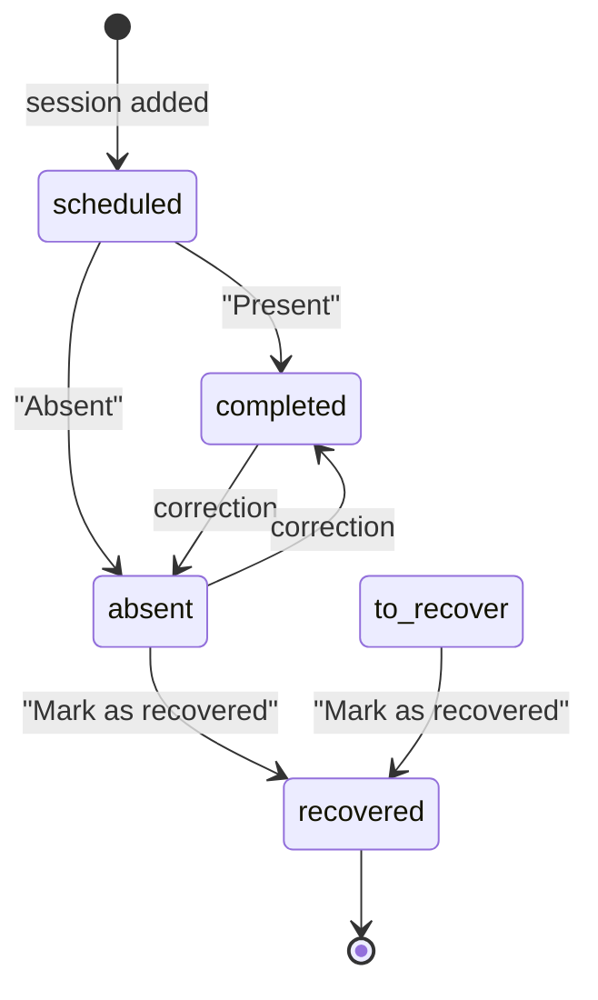
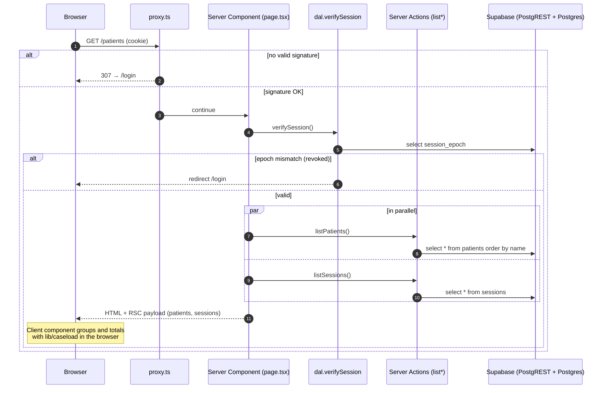
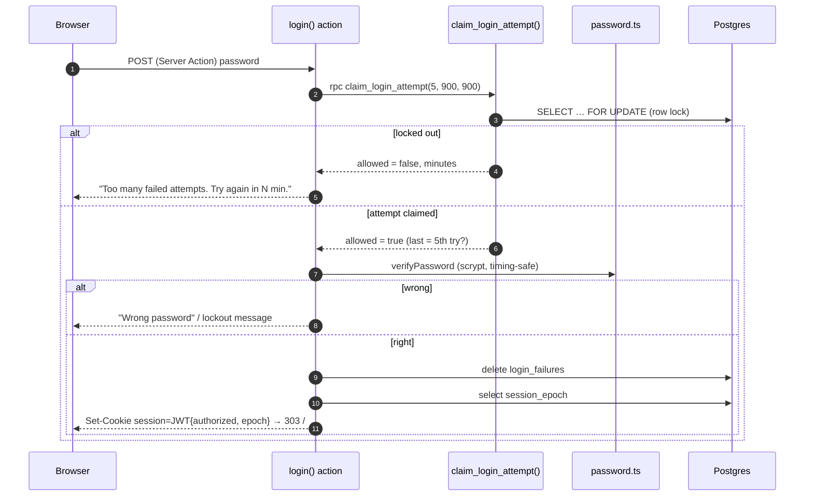
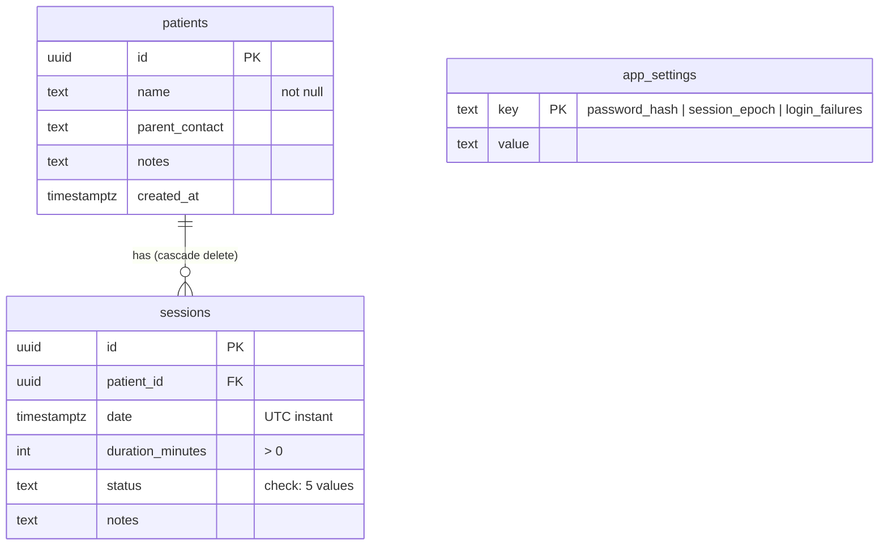

# Architecture audit

Audit of OpenCaseload, November 2026: how it is built, the business rules it
implements, how data moves, and where performance and maintainability stand.
The security side is in [SECURITY_REPORT.md](SECURITY_REPORT.md).

## 1. What the system is

A self-hosted, single-practice web app for a therapist. It keeps a list of
patients, the sessions with each of them, which sessions took place or were
missed, which missed hours have been recovered, and produces monthly PDF and
Excel reports per patient.

There is **one user** (the therapist) and **one shared password**. Each
practice deploys its own instance and is the data controller.

| Layer | Technology |
|---|---|
| UI | React 19 client components, Tailwind CSS v4, shadcn/ui (Base UI) |
| Server | Next.js 16 App Router: Server Components, Server Actions, `proxy.ts` |
| Auth | scrypt password hash, HS256 JWT cookie (jose), session epoch, throttle |
| Data | Supabase Postgres via PostgREST, service role key, server side only |
| Reports | jsPDF + jspdf-autotable, SheetJS 0.20.3, generated in the browser |
| Tests | Vitest (unit), Vitest + Docker Postgres/PostgREST (integration) |

## 2. Module map

```
src/
├─ proxy.ts                    optimistic gate: no signed cookie → /login
├─ app/
│  ├─ layout.tsx               shell, fonts, theme colour, bottom navigation
│  ├─ page.tsx                 Dashboard (server) → DashboardClient
│  ├─ patients/                Patients (server) → PatientsClient (+ reports)
│  ├─ recoveries/              Recoveries (server) → RecoveriesClient
│  ├─ settings/                Settings (server guard) → SettingsClient
│  ├─ login/page.tsx           sign-in form (useActionState)
│  ├─ actions/
│  │  ├─ auth.ts               login, logout, logoutEverywhere, changePassword
│  │  ├─ patients.ts           list/create/update/delete patients
│  │  └─ sessions.ts           list/create/status/delete/recover sessions
│  ├─ icon.tsx, apple-icon.tsx, manifest.ts   PWA icons and manifest
├─ lib/
│  ├─ dal.ts                   verifySession(): signature + epoch (the real gate)
│  ├─ session.ts               JWT cookie: issue, verify, delete
│  ├─ sessionEpoch.ts          revocation counter in app_settings
│  ├─ password.ts              scrypt hash, first-run password
│  ├─ loginThrottle.ts         atomic attempt claim (Postgres function)
│  ├─ validation.ts            input checks for every Server Action
│  ├─ caseload.ts              pure business arithmetic (days, weeks, hours)
│  ├─ dates.ts                 instance-time-zone date helpers
│  ├─ exportUtils.ts           PDF / Excel reports
│  ├─ supabaseAdmin.ts         service-role client (server-only)
│  └─ branding.ts              per-instance names, locale, time zone
├─ types/database.ts           Patient, Session, statuses and their meaning
└─ test/                       fake Supabase, dataset, integration tests
supabase/
├─ schema.sql                  tables, constraints, RLS, throttle function
├─ migrations/                 upgrades for existing databases
├─ seed/test-data.sql          invented dataset (generated)
└─ test/                       roles + gateway for the Docker test stack
```

Dependency direction is strictly one way: `app/*Client.tsx` → `lib/caseload`,
`lib/dates` → `types`; `app/actions` → `lib/dal`, `lib/validation`,
`lib/supabaseAdmin`. Nothing in `lib/` imports from `app/`. Every module that
touches secrets imports `server-only`, so importing it from a client
component fails the build.

## 3. Business logic

### 3.1 Patients
A patient has a name (required, ≤ 120 characters), a parent/guardian contact
and notes (≤ 2000). Deleting a patient deletes their sessions
(`on delete cascade`).

### 3.2 Sessions and their status



`to_recover` exists in the schema (and old data) but the UI never sets it; it
behaves exactly like `absent`. The rules live in `types/database.ts`:

| Predicate | Statuses | Used for |
|---|---|---|
| `isWorkedSession` | `completed` | hours worked, report totals |
| `isMissedSession` | `absent`, `to_recover`, `recovered` | "missed" in reports |
| `needsRecovery` | `absent`, `to_recover` | Recoveries page |

`recoverSessions` only ever moves `absent`/`to_recover` to `recovered`, even
if other ids are sent.

### 3.3 Hours

* **Hours worked** count only sessions that took place.
* **Group sessions**: several patients with the same start and duration form
  one time slot. On the dashboard a slot counts **once** if anyone attended
  (the therapist worked one hour, not three).
* **Per patient** (cards and reports) each patient's own completed sessions
  count, so a group hour appears in each attending child's report.
* **Missed** sessions are reported separately and never added to hours worked.
* **Owed hours** (Recoveries) are the minutes of sessions still needing
  recovery, per patient.

### 3.4 Time zone
Sessions are stored as UTC instants. Every "which day / week / month is this
in" question is answered in the instance time zone (`NEXT_PUBLIC_TIMEZONE`),
never in the server's or the browser's, so a session at 00:30 on 1 November in
Rome is a November session even though it is 31 October in UTC, and the server
and browser render identical HTML. `zonedToUtcISO` converts the wall-clock time
typed in the form back to UTC across DST changes.

### 3.5 Reports
For a selected month (or everything), per patient: date, time, duration,
status and notes of each session, then a **HOURS WORKED** row and a **MISSED**
row. Generated in the browser; file names are sanitised (`Report_Niccolo_Perez.pdf`).

### 3.6 Authentication
One password. First run: `APP_INITIAL_PASSWORD` (refused if it is the example
value or shorter than 8). After the first change, only the scrypt hash in
`app_settings` counts. Sessions are 30-day HS256 JWT cookies carrying the
*session epoch*; bumping the epoch (password change, "sign out of all
devices") revokes every older cookie.

## 4. Data flows

### 4.1 Request flow (page load)



### 4.2 Sign-in



### 4.3 Mutations
Client components call Server Actions directly (`createTherapySession`,
`updateSessionStatus`, …). Each action: `verifySession()` → validate input →
one PostgREST call → `{ data, error }`. The client updates its local state
only on success, and shows the error otherwise.

### 4.4 Data model



## 5. Performance

### 5.1 Found and fixed

| Issue | Where | Before | After |
|---|---|---|---|
| Patient lookup inside loops | Dashboard (today, week), Recoveries | `patients.find()` per session: O(P × S) | `Map` built once: O(P + S) |
| Per-card session filtering | Patients page | each card filtered all sessions: O(P × S) per render | `groupByPatient` once (memoised): O(S) |
| `zonedParts` | every date grouping | 6 `formatToParts` calls per date | 1 call per date (≈ 6× fewer on the hottest path) |
| Report libraries in the page bundle | Patients page | jsPDF + SheetJS (~830 KB raw) loaded with the page | loaded on first export click (`import()`) |
| Week grouping key | Dashboard | grouped by formatted label string | grouped by day key, ordered by the week array |

### 5.2 Remaining bottlenecks

1. **Whole history on every page.** `listSessions()` returns every session
   ever recorded, to every page, and grouping happens in the browser. Fine for
   a few thousand sessions (one therapist, years of work), but the payload and
   the per-render work grow without bound. Next step: load only the range a
   page needs (today/this week for the dashboard, the selected month for
   reports, `status in (absent, to_recover)` for recoveries) with indexed
   queries (`sessions_date_idx` already exists).
2. **One extra query per request** for the session epoch in `verifySession`
   (cached per request by React `cache`). A few milliseconds; the price of
   instant revocation. Could be cached in memory for ~30 s if it ever matters.
3. **No N+1 queries**: each page does exactly two queries, in parallel.
4. **Group-session time slots** are keyed by exact start instant; sessions
   created through the UI are minute-aligned, so this is exact.

## 6. Technical debt

| # | Item | Impact | Suggestion |
|---|---|---|---|
| 1 | Reads exposed as Server Actions (`listPatients`, `listSessions`) | They are public POST endpoints (guarded by `verifySession`); the Next.js docs describe Server Functions as designed for mutations, and they are queued one at a time on the client | Move reads to plain `server-only` functions called by pages |
| 2 | No revalidation after mutations | Two open tabs drift apart until reload | `revalidatePath` or `router.refresh()` after writes |
| 3 | `window.alert` / `window.confirm` for errors and confirmation | Crude UX, blocks the thread | Dialog/toast components |
| 4 | Hard-coded English strings | No translation possible | Message catalogue (next-intl or similar) |
| 5 | `to_recover` status never set by the UI; `Availability` type unused | Dead model surface | Remove, or build the feature |
| 6 | `DashboardClient.tsx` ≈ 340 lines mixing view and form | Hard to read | Split into `TodayView`, `WeekView`, `NewSessionDialog` |
| 7 | No generated database types | Column renames are not caught at compile time | `supabase gen types typescript` |
| 8 | SheetJS installed from its CDN tarball | Dependabot/npm audit do not track it | Watch SheetJS releases manually, or switch to CSV/ExcelJS |
| 9 | `schema.sql` repeats the throttle function from its migration | Two copies to keep in sync | Accept (documented), or build schema.sql from migrations |
| 10 | CSP needs `'unsafe-inline'` for scripts | Weaker XSS defence-in-depth | Nonce-based CSP via proxy (all pages become dynamic) |
| 11 | Node 20 reached end of life (April 2026) | No security fixes; supabase-js wants native WebSocket (Node 22+) | CI and `.nvmrc` moved to 22; raise `engines` when ready |
| 12 | Single shared password, global throttle | See SECURITY_REPORT M1 | Supabase Auth (already on the roadmap) |

## 7. Changes made during this audit

* `lib/caseload.ts`: business arithmetic extracted from the three page
  components into pure, tested functions; pages now only render.
* `lib/validation.ts`: one place for input rules; every Server Action uses it.
* `lib/sessionEpoch.ts`, `lib/dal.ts`, `lib/session.ts`: revocable sessions.
* `lib/loginThrottle.ts` + `claim_login_attempt()`: atomic throttling.
* Functional state updates (`setX(prev => …)`) instead of stale closures in
  the client components; error handling on every mutation.
* Settings page gained a server-side session check and "Sign out of all devices".
* Security headers in `next.config.ts`, `X-Powered-By` removed.
* Test suite: see the summary at the end of SECURITY_REPORT.md and
  CONTRIBUTING.md.
